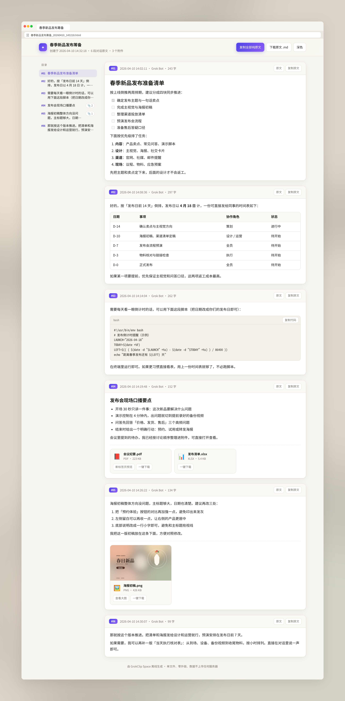
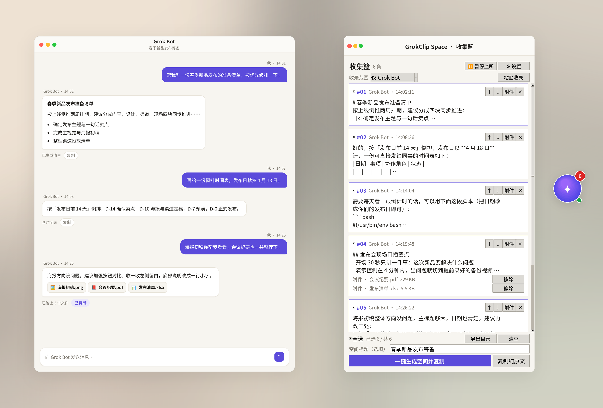

# GrokClip Space · 桌面悬浮收集球 + 离线 HTML 空间

> *A zero-cost, offline desktop collector for Grok Bot replies and files (macOS / Windows / Linux) that packs them into one shareable offline HTML file.*

**一句话**：在 Grok Bot 里点「复制」，悬浮球自动收集原文和同期下载的文件，一键打包成一个双击就能打开的离线 HTML「空间」，直接粘贴到微信 / 飞书转发。

[快速开始](#一安装) · [怎么用](#二日常怎么用三个平台相同) · [试用说明](docs/试用说明.md) · [常见问题](#四常见问题) · [隐私](PRIVACY.md) · [更新日志](CHANGELOG.md) · [参与贡献](CONTRIBUTING.md)

## 功能

- **点复制即收录**：只认 Grok Bot（可切换「Grok + 浏览器」「全部应用」），密码管理器内容自动跳过，SHA-256 去重
- **文件自动挂载**：前后 120 秒内落地的下载文件自动挂到对应原文下（先下载后复制也能认领），也可手动挂载
- **收集篮整理**：按收录顺序 `#01`、`#02`… 编号，可勾选、排序、删除、改标题
- **一键生成空间**：单个 `.html` 文件，内嵌原文（Markdown 排版 / 原文切换）、图片、PDF、文档附件，并以「文件」形式写进剪贴板
- **复制纯原文**：零改写、无水印地拼接勾选原文
- **零成本零依赖**：不要账号、不要签名、不联网、没有第三方库；数据只在本机

## 截图

对方收到空间文件后，双击即可在浏览器里按收录顺序回看全部原文和附件，像在看一份「聊天记录」：



*对方双击打开后看到的空间*

收集端是桌面上的紫色悬浮球。在 Grok Bot 里点「复制」，原文和同期文件就会收进收集篮，再一键生成上面这样的空间：



*悬浮球与收集抽屉*


*复制 → 悬浮球收集 → 对方双击打开*

## 支持哪些系统

| | macOS | Windows | Linux（X11） | Linux（Wayland） |
| --- | --- | --- | --- | --- |
| 收集端实现 | Swift 原生 App | Python + Tkinter | Python + Tkinter | Python + Tkinter |
| 系统要求 | macOS 13+ | Windows 10 / 11 + Python 3.9+ | Python 3.9+、python3-tk | Python 3.9+、python3-tk |
| 额外工具 | Xcode 命令行工具 | 无 | `xclip`、`xdotool` | `wl-clipboard` |
| 自动收录复制内容 | ✅ | ✅ | ✅ | ✅ |
| 只收录 Grok（识别前台应用） | ✅ | ✅ | ✅ | ⚠️ 系统不允许，自动改为「全部应用」 |
| 跳过密码管理器内容 | ✅ | ✅ | ✅ | ✅ |
| 下载文件自动挂载（双向 120 秒） | ✅ | ✅ | ✅ | ✅ |
| 空间以「文件」写入剪贴板 | ✅ | ✅（CF_HDROP） | ✅（uri-list） | ✅（uri-list） |
| 文件拖到悬浮球 / 卡片 | ✅ | 可选（需自行安装 `tkinterdnd2`），默认用「附件」按钮 | 同左 | 同左 |
| 生成的空间格式 | 完全相同 | 完全相同 | 完全相同 | 完全相同 |

**验证情况**

| 平台 | 状态 |
| --- | --- |
| macOS | ✅ 已在真机（macOS 26 / Apple 芯片）编译、安装并运行 |
| Linux（X11） | ✅ 已在 Xvfb 虚拟桌面里真实运行：收录、去重、白名单、密码标记、双向挂载、生成空间、写剪贴板，27 项端到端检查全部通过 |
| Linux（Wayland） | ⚠️ 代码已实现（wl-clipboard），尚未在真实 Wayland 桌面验证 |
| Windows | ⚠️ 尚未在真实 Windows 上运行。Win32 剪贴板代码已逐项审查，并用模拟的系统 API 跑过单元测试（内存布局、CF_HDROP、敏感格式、自写不回环）；界面细节（透明悬浮球、不抢焦点、托盘外菜单）待真机确认 |

欢迎在 Windows / Wayland 上试用后[提交反馈](docs/试用说明.md#如何反馈)。

生成的 `.html` 空间在任何电脑和手机浏览器上都能打开。三个平台用的是**同一份 HTML 模板**，生成结果逐字节一致（只有时间字段不同）。

---

## 一、安装

### macOS

**要求**：macOS 13 Ventura 或更新版本（Apple 芯片和 Intel 都支持），并已安装命令行工具。如果没装过，先运行一次：

```bash
xcode-select --install
```

解压后在终端进入这个目录，运行：

```bash
cd GrokClipSpace
bash install.sh
```

脚本会依次完成：编译 → 生成 App 图标 → 自检 → 本地 ad-hoc 签名 → 安装到「应用程序」（没有写入权限时改装到 `~/Applications`）→ 启动。启动后，屏幕右侧有一个**紫色悬浮球**，顶部菜单栏有一个 ✦ 图标。程序不在 Dock 栏占位。

> 只想构建、不安装：运行 `bash build.sh`，产物在 `build/GrokClip Space.app`。
> 想编出 Apple 芯片和 Intel 都能用的通用版：运行 `UNIVERSAL=1 bash build.sh`。

### Windows

1. 安装 Python 3.9 或更新版本（免费）：到 [python.org](https://www.python.org/downloads/windows/) 下载安装包，安装时勾选 **Add python.exe to PATH**，保持默认勾选的 **tcl/tk and IDLE**。
2. 解压 `GrokClipSpace.zip`，进入 `GrokClipSpace\crossplatform`。
3. **直接试用**：双击 `run_windows.bat`，屏幕右侧会出现紫色悬浮球。
4. **安装快捷方式（可选）**：在该目录打开 PowerShell，运行

   ```powershell
   powershell -ExecutionPolicy Bypass -File .\install_windows.ps1            # 「开始」菜单快捷方式
   powershell -ExecutionPolicy Bypass -File .\install_windows.ps1 -Startup   # 另外设置开机自启
   powershell -ExecutionPolicy Bypass -File .\install_windows.ps1 -Uninstall # 移除快捷方式
   ```

   只装在当前用户下，不需要管理员权限。`-ExecutionPolicy Bypass` 只对这一次运行生效，不改系统设置。

> 双击没反应？在该目录运行 `run_windows.bat --console`，窗口里会显示具体错误。
> 自检：`run_windows.bat --self-test %USERPROFILE%\Desktop\test.html`，然后双击生成的 `test.html` 查看示例空间。

### Linux

1. 安装依赖（按你的发行版选一行）：

   ```bash
   # Debian / Ubuntu
   sudo apt install python3 python3-tk xclip xdotool        # X11
   sudo apt install python3 python3-tk wl-clipboard         # Wayland
   # Fedora
   sudo dnf install python3 python3-tkinter xclip xdotool wl-clipboard
   # Arch
   sudo pacman -S python tk xclip xdotool wl-clipboard
   ```

2. 解压后进入 `GrokClipSpace/crossplatform`：

   ```bash
   bash run_linux.sh --check      # 检查依赖，缺什么会打印对应的安装命令
   bash run_linux.sh              # 直接试用
   bash install_linux.sh          # 添加到应用菜单并启动（不需要 sudo）
   bash install_linux.sh --autostart   # 另外设置登录后自动启动
   bash install_linux.sh --uninstall   # 移除菜单入口与自启动
   ```

> **Wayland 用户注意**：Wayland 出于安全设计，不允许程序读取其他应用的窗口，所以没法判断「当前是不是在 Grok 里复制」。这时程序会自动按「全部应用」收录，并在收集篮顶部显示提醒。复制密码前可以先在收集篮里暂停监听；KeePassXC 等会标记敏感内容的密码管理器复制的内容仍会被自动跳过。如果想要「只收录 Grok」，可以在登录界面选择 X11（Xorg）会话。

---

## 二、日常怎么用（三个平台相同）

### 1. 收录原文
在 Grok Bot 的对话里，对想要的那几条回复依次点官方的「复制」按钮。每点一次，悬浮球会轻轻弹一下，并提示 `+1 已收录 #03`。

- **只认 Grok Bot**：默认只收录 Grok Bot 里复制的内容（Windows / Linux 按前台窗口的进程名或标题是否包含 “Grok” 判断，网页版 Grok 的浏览器标签也能识别）。需要时可以在收集篮顶部把范围切到「Grok + 浏览器」或「全部应用」。
- **密码不会被收**：密码管理器复制的内容带有敏感标记，会被自动跳过。
- **不会重复**：连续点同一条的「复制」，也只会收录一次。
- **程序自己写进剪贴板的内容**（复制纯原文、复制空间文件）不会被再次收录。

### 2. 文件自动挂载
默认监听「下载」文件夹；如果你的主目录下有 `grok bot` 文件夹，也会一起监听。新文件**完整写入**之后（下载中的 `.crdownload`、`.part`、`.tmp` 等临时文件会被忽略）：

- 如果最近一条原文是 120 秒内收录的，文件直接挂到这条原文下面；
- 如果文件先下载、原文后复制，下一条收录的原文会把这 120 秒内落地的文件自动认领过来；
- 超出时间窗口的文件会出现在收集篮的「新落地的文件」栏，点「挂到最新」即可挂载。

也可以手动挂载：点卡片上的「附件」按钮选择文件（macOS 和装了 `tkinterdnd2` 的 Windows / Linux 还支持把文件拖到悬浮球或卡片上）。

### 3. 整理
单击悬浮球打开收集篮（Windows / Linux 右键悬浮球有完整菜单）。条目按收集顺序编号为 `#01`、`#02`……，导出的空间也是这个顺序。在收集篮里可以：

- 勾选或取消条目、全选
- 用 ↑ ↓ 调整顺序
- 删除条目，或移除某个附件（磁盘上的原文件不会被删除）
- 填写「空间标题」（选填）
- 点「粘贴收录」，把当前剪贴板里的内容（文本或文件）直接收进来，不受收录范围限制

### 4. 一键转发
| 按钮 | 作用 |
| --- | --- |
| **一键生成空间并复制** | 生成 `GrokSpace_日期_时间.html`（填了标题就用标题命名），保存到导出目录，并把这个**文件**写进剪贴板。切到微信或飞书，`⌘V` / `Ctrl+V` 就能发出去 |
| **复制纯原文** | 把勾选条目的原文用空行拼接后写进剪贴板，一个字都不改，也不加水印 |
| 浏览器打开 / 打开所在文件夹 | 生成空间后出现；macOS 另有「系统分享」（隔空投送、邮件、备忘录等） |

Windows / Linux 收集篮快捷键：`Ctrl+Enter` 生成空间并复制，`Ctrl+Shift+C` 复制纯原文，`Ctrl+Shift+V` 粘贴收录，`Esc` 收起。

导出目录默认是 `~/grok bot`（这个文件夹存在时）；不存在时是桌面上的 `GrokSpaces` 文件夹。可以在设置里修改。

### 5. 对方打开「空间」后能做什么
对方双击 `.html` 文件，用任意浏览器都能离线打开：

- 左侧目录可以跳转到 `#01`…`#NN`；每段原文支持「排版 / 原文」切换和一键复制，代码块也有单独的「复制代码」按钮
- 顶部有「复制全部纯原文」「下载原文 .md」和深浅色切换
- 附件直接显示在对应那段原文下面：图片可放大和下载原图；PDF 可在新标签页预览；文本、代码、CSV、JSON 可展开查看和复制；Word、Excel、PPT、ZIP 等可一键下载
- 内嵌上限是单个文件 25 MB、全部附件合计 80 MB。超过上限的文件会在卡片上提示「请单独发送原文件」

---

## 三、分享给朋友

把整个 `GrokClipSpace` 文件夹打成 zip 发给对方即可。zip 里只有源码和脚本，没有编译好的程序：

- macOS：对方运行 `bash install.sh`，在自己的 Mac 上本地编译，不会遇到「无法验证开发者」的拦截
- Windows：对方装好 Python 后双击 `crossplatform\run_windows.bat`
- Linux：对方运行 `bash crossplatform/install_linux.sh`

> 经过微信等渠道传输后，脚本可能丢失可执行权限。请用 `bash 脚本名.sh` 运行。

---

## 四、常见问题

- **复制了却没收录？** 先看悬浮球右下角的小圆点：绿色表示正在监听，灰色表示已暂停或缺少剪贴板工具。再确认收集范围；如果你用网页版 Grok，请把范围切到「Grok + 浏览器」。
- **Windows / Linux 识别不到 Grok？** 可以设置环境变量 `GROKCLIP_EXTRA_APPS`（逗号分隔的进程名或标题关键词）补充识别规则，或把收录范围切到「全部应用」。
- **文件没有自动挂上？** macOS 第一次监听「下载」等目录时可能弹窗请求访问权限，请点「允许」。Windows / Linux 请在设置里确认监听目录是否正确。
- **开机自启**：macOS 在菜单栏图标里勾选；Windows 用 `install_windows.ps1 -Startup`；Linux 用 `install_linux.sh --autostart`。
- **数据存在哪里？** 见 [PRIVACY.md](PRIVACY.md) 的表格。三个平台的 `clips_store.json` 结构相同，都是原子写入，其他脚本或 AI Skill 可以放心直接读取。
- **卸载**：macOS 先在菜单栏选择退出，再删除 `/Applications/GrokClip Space.app` 和数据目录；Windows 运行 `install_windows.ps1 -Uninstall` 后删除 `%APPDATA%\GrokClipSpace`；Linux 运行 `install_linux.sh --uninstall` 后删除 `~/.local/share/GrokClipSpace`。

---

## 五、源码结构

```
GrokClipSpace/
├── Sources/                     # macOS 原生版（Swift）
│   ├── main.swift               # AppKit 入口 + --self-test 冒烟测试
│   ├── AppDelegate.swift        # 悬浮球 / 收集篮 / Toast 三个面板 + 菜单栏
│   ├── PetViews.swift           # 悬浮球（Core Animation）与收集篮界面（SwiftUI）
│   ├── ClipStore.swift          # 状态、120 秒双向关联、导出、持久化
│   ├── ClipboardMonitor.swift   # 剪贴板监听、敏感类型过滤、来源白名单、去重
│   ├── DownloadWatcher.swift    # 多目录线程安全监听 + 文件写入稳定性检测
│   ├── SpaceHTMLGenerator.swift # 离线 HTML 空间生成器（HTML 模板的唯一来源）
│   └── Models.swift             # 数据模型与设置
├── build.sh / install.sh        # macOS 构建与一键安装
├── crossplatform/               # Windows / Linux 版（Python 标准库 + Tkinter）
│   ├── grokclip/
│   │   ├── __main__.py          # 入口（python -m grokclip，支持 --self-test）
│   │   ├── app_ui.py            # 悬浮球、收集篮、设置、Toast
│   │   ├── store.py             # 状态、120 秒双向关联、持久化（对应 ClipStore.swift）
│   │   ├── models.py            # 数据模型（JSON 结构与 macOS 版一致）
│   │   ├── space_html.py        # 空间生成器（对应 SpaceHTMLGenerator.swift）
│   │   ├── space_template.html  # 从 Swift 源码逐字提取的同一份模板
│   │   ├── watcher.py           # 多目录轮询监听 + 大小稳定检测
│   │   ├── clipboard_base.py    # 来源白名单、去重、后台监听线程
│   │   ├── clipboard_win.py     # Windows：ctypes 调用 Win32 剪贴板 API
│   │   ├── clipboard_linux.py   # Linux：xclip / xsel / wl-clipboard / xdotool
│   │   ├── platform_paths.py    # 下载 / 桌面 / 数据目录（运行时解析）
│   │   ├── system.py            # 打开文件、文件管理器定位、单实例锁
│   │   └── selftest.py          # 自检
│   ├── run_windows.bat / install_windows.ps1
│   ├── run_linux.sh / install_linux.sh
│   ├── tools/sync_template.py   # 从 Swift 源码同步 HTML 模板
│   └── tests/                   # 单元测试 + Linux 端到端测试
├── docs/
│   ├── 试用说明.md               # 面向非技术试用者的分步指南
│   └── images/                  # README 截图
├── .github/                     # Issue / PR 模板
├── README.md · PRIVACY.md · CHANGELOG.md · CONTRIBUTING.md · SECURITY.md · LICENSE
```

**修改空间模板**：只改 `Sources/SpaceHTMLGenerator.swift` 里的模板，然后运行 `python3 crossplatform/tools/sync_template.py` 同步。单元测试会检查两边是否一致。

**运行测试**（任意平台）：

```bash
cd crossplatform
python3 -m unittest discover -s tests
python3 tools/sync_template.py --check
```

---

## 六、隐私与许可证

- **隐私**：完全离线、零第三方依赖、不收集任何账号信息，详见 [PRIVACY.md](PRIVACY.md)。生成的空间会内嵌你勾选的原文和附件，发送前请确认内容可以外发。
- **许可证**：[MIT](LICENSE)
